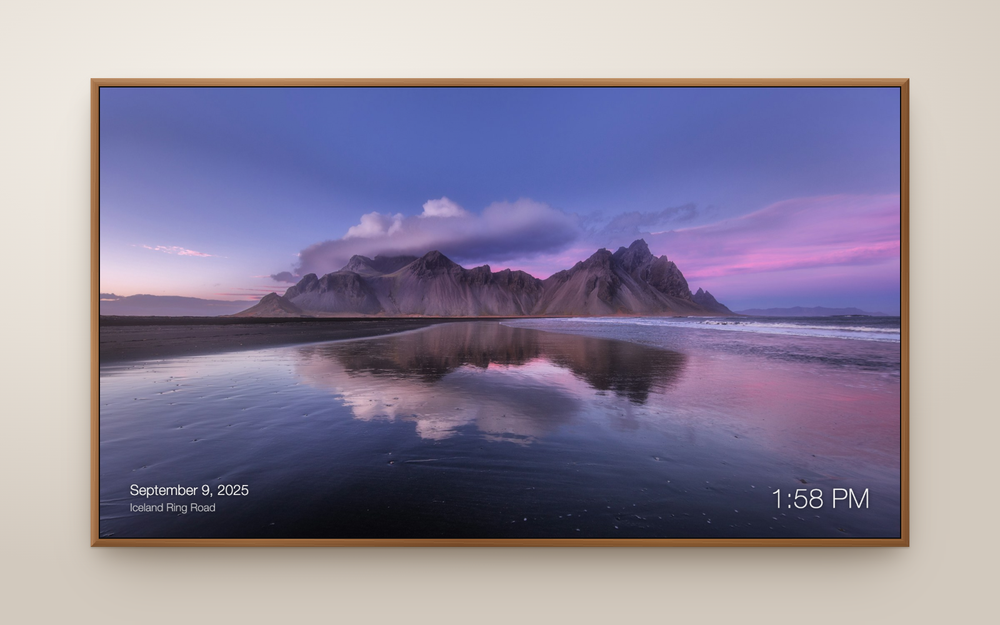
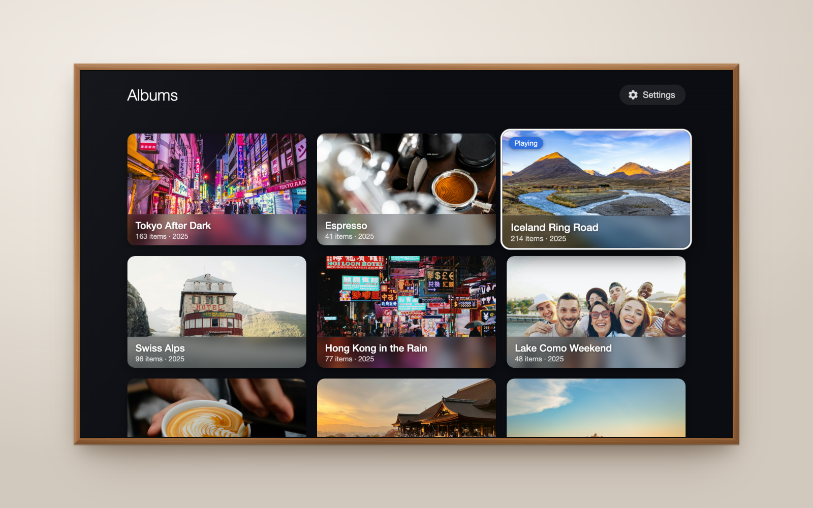
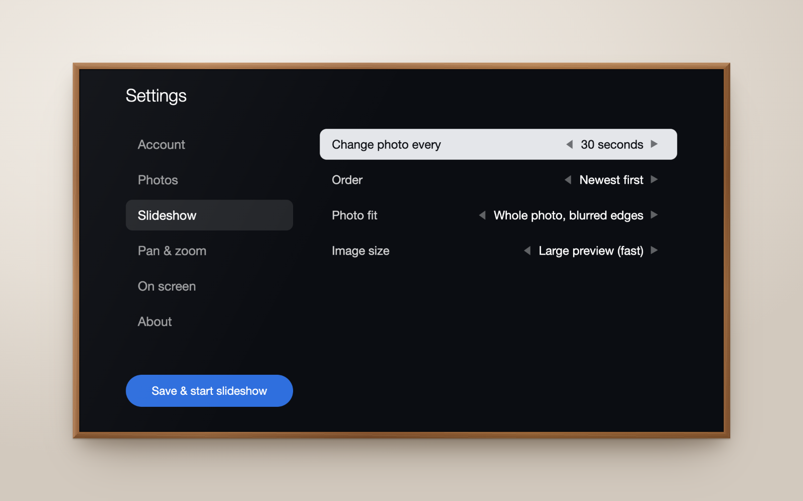

# Shutter

*The unofficial Synology Photos app for Samsung TV.*



<table>
  <tr>
    <td></td>
    <td></td>
  </tr>
  <tr>
    <td align="center">Pick an album</td>
    <td align="center">Settings, on the TV</td>
  </tr>
</table>

A Samsung TV (Tizen) app that plays a slideshow of your **Synology Photos** library:
all your photos, a single album, or Shared Space, with crossfades, a slow pan and zoom,
the date each photo was taken, and a clock.

> **About Art Mode:** Samsung doesn't let third-party apps draw in the Frame's Art Mode.
> This app runs as a normal TV app, so the TV stays in TV mode while it plays. The app
> turns off the TV's screensaver while it's open. Brightness and power schedules still
> come from the TV's own settings.

## 1. Prepare your Synology

1. In DSM, create a dedicated user (e.g. `photoframe`) and give it access to Synology Photos.
   Share the albums you want with it, or let it see the Shared Space.
   *Don't* turn on 2-factor sign-in for this user; the TV can't enter codes.
2. Find the NAS's LAN address, e.g. `http://192.168.1.20:5000`.
   Port 5000 is HTTP and 5001 is HTTPS, so `http://…:5001` won't work. Use plain `http://` on the LAN, or `https://` only with a valid certificate
   (the TV rejects self-signed ones).

## 2. Put the TV in Developer Mode

1. On the TV, open **Apps**, then type `1 2 3 4 5` on the remote's number pad
   (or the on-screen one).
2. Turn **Developer mode** on, enter your Mac's IP address as **Host PC IP**, and press OK.
3. **Unplug the TV from the wall for 60 seconds**, then turn it back on. Restarting with the
   remote (even holding the power button) isn't enough. Until the TV is cold-booted, it says
   Developer Mode is on but refuses connections.

## 3. Install the tools (one time)

```bash
curl -LO https://download.tizen.org/sdk/Installer/tizen-studio_6.1/web-cli_Tizen_Studio_6.1_macos-64.bin
```

```bash
bash web-cli_Tizen_Studio_6.1_macos-64.bin --accept-license ~/tizen-studio
```

```bash
~/tizen-studio/package-manager/package-manager-cli.bin install --accept-license TV-SAMSUNG-Extension-Tools TV-SAMSUNG-Extension-Resources
```

Then create a signing certificate and profile (pick your own password):

```bash
~/tizen-studio/tools/ide/bin/tizen certificate -a Shutter -n "Shutter" -p <password> -f shutter
```

```bash
~/tizen-studio/tools/ide/bin/tizen security-profiles add -n Shutter -a ~/tizen-studio-data/keystore/author/shutter.p12 -p <password>
```

A plain Tizen certificate works on a 2022 Frame (QE50LS03B, Tizen 6.5). If your TV rejects the
install with a certificate error, install `cert-add-on` and create a **Samsung** certificate
in the Certificate Manager (`~/tizen-studio/tools/certificate-manager`). That needs your
Samsung account and the TV's DUID.

## 4. (Optional) Pre-fill the settings

Typing with a TV remote is tedious. Before building, you can fill in `server`, `account`
and `password` in [js/config.js](js/config.js). Otherwise the app opens its settings screen on first launch.
Don't commit a real password: `git update-index --skip-worktree js/config.js` keeps git from
picking up your local edits.

## 5. Build and install

```bash
dev/deploy.sh <TV-IP>
```

This builds, signs, installs and launches the app; run it again after any change. The app
appears under **Apps** as *Shutter*. (Use `dev/deploy.sh` rather than `tizen install`:
the TV's installer fails on the default package name, which contains a space.)

## Using it

| Remote | Action |
| --- | --- |
| ◀ ▶ / ⏪ ⏩ | Previous / next photo |
| OK / ⏯ | Pause / resume |
| ▲ / Info | Photo details: date and time taken, album, file name and size, position (▲ or Back closes; closes itself after 8 s) |
| ▼ | Albums: browse covers, OK to play one; ▲ from the top row reaches Settings (top right) |
| Color keys | Settings |
| Back | Slideshow: open Albums (closes photo info first). Albums: asks "Exit?" (Cancel is selected; Back cancels); OK on the *Playing* album returns to the slideshow. Settings: back to the categories, then to the album grid |

On the settings screen, use ▲▼ to move, ◀▶ to change a choice, and OK to type into a field.
Choose **Connect & load albums** to check your sign-in and list your albums.

New photos are picked up every 6 hours (or right away when you press *Save & start* in settings).

## Trying it on your Mac

`dev/mock_server.py` fakes a Synology so you can run the app in a browser:

```bash
python3 dev/mock_server.py
```

Then open http://localhost:8080, use the address `localhost:8080`, any username, and the
password `demo`. Use the arrow keys, Enter, and Esc as the remote.
`--session-seconds 4` makes sessions expire quickly, to test signing in again.

To try it against your real NAS from the browser, proxy the API (the TV calls the NAS
directly, but browsers block that because DSM sends no CORS headers):

```bash
python3 dev/mock_server.py --port 8082 --proxy http://192.168.1.20:5000
```

Then open http://localhost:8082 and use `localhost:8082` as the DSM address.

### Screenshots

The images at the top come from the real app, against a demo library in the mock server
(`--showcase`, see [dev/showcase.py](dev/showcase.py)) with photos from Unsplash. To make
them again after a UI change:

```bash
python3 dev/showcase.py --fetch
```

```bash
python3 dev/mock_server.py --port 8090 --showcase
```

```bash
dev/screenshots.sh
```

The first downloads the photos (they aren't in the repo), the second serves the demo
library, and the third captures each screen at 1920x1080 with headless Chrome and puts it
on a TV drawn in the proportions of a 55" The Frame ([dev/mockup.html](dev/mockup.html)).

## Notes

- Built for 2017+ Frame TVs (Tizen 3.0, Chromium 47), so the code avoids newer JavaScript.
- **Image size**: "Large preview" uses Synology's own preview (1920px on recent versions, smaller
  on older versions), which is fast and works
  for every format. "Original file" is sharper on 4K panels but slower. If the TV can't
  decode an original (e.g. HEIC), the app falls back to the preview for that photo.
- The password is stored on the TV (in the app's local storage). Use a dedicated,
  low-privilege DSM account.
- The TV talks to the NAS directly on your home network. QuickConnect and other remote
  addresses aren't supported.
- To start faster, the app keeps the photo list, the sign-in session and the album covers
  on the TV between launches.
- Synology Photos' web API is undocumented. This app uses the same calls as Synology's web
  client and community tools. A future Synology Photos update could change them.

## Troubleshooting

- **Connects but finds no photos or albums**: the DSM user only sees its own photos and albums
  shared with it. In Synology Photos (signed in as yourself), open an album → **Share** → add the
  frame's user. For Shared Space, give the user access under Synology Photos → Settings → Shared Space.
- **`dev/login-test.html`** (open it through `dev/mock_server.py --proxy …`) checks sign-in and
  Photos access for an account, showing only result codes.

- **Can't connect to the TV** (`sdb connect` fails although Developer Mode is on): unplug
  the TV for 60 seconds. If it still fails, turn Developer Mode off, cold-boot, turn it on
  with your Mac's IP, and cold-boot again.

- **"Cannot reach …"**: check the address and port, and that the TV and NAS are on the same network.
- **"Wrong username or password"**: after several failures DSM blocks the TV's IP.
  Check *Control Panel → Security → Protection*.
- **"2-factor sign-in"**: use an account without 2FA.
- **"Synology Photos is not available"**: the Synology Photos package isn't installed,
  or the address points at something other than DSM.

## License

© 2026 Khanh Ly. Released under the [MIT License](LICENSE).

Photos in the screenshots are from [Unsplash](https://unsplash.com), used under the
[Unsplash License](https://unsplash.com/license):

- [Vestrahorn, Iceland](https://unsplash.com/photos/ruWkmt3nU58) by Luca Micheli
- [River valley, Iceland](https://unsplash.com/photos/W3_MIcf4nyE) by 35MM North
- [Hotel on a mountain pass](https://unsplash.com/photos/tFo8WNjvX9I) by Chris Weiher
- [Friends taking a selfie](https://unsplash.com/photos/-WBVWFBfoEc) by Vitaly Gariev
- [Temple in autumn, Kyoto](https://unsplash.com/photos/YbcX7QktfjA) by Omkar Jori
- [St Michael's Mount](https://unsplash.com/photos/-EHDvg8o_zE) by BEN ELLIOTT
- [Wadi Rum](https://unsplash.com/photos/IDYdmpjQXZQ) by Rita
- [Aurora over snowy mountains](https://unsplash.com/photos/EvKBHBGgaUo) by Jonatan Pie
- [Cabin by a forest lake](https://unsplash.com/photos/B6IIw00D1gA) by Michael Kahn
- [Tokyo street at night](https://unsplash.com/photos/_noSmX8Kgoo) by Jezael Melgoza
- [Hong Kong neon in the rain](https://unsplash.com/photos/DdQkVaQbSsg) by Nic Low
- [Espresso portafilter](https://unsplash.com/photos/pRzbLPQOnwM) by Marko Alpner
- [Making coffee](https://unsplash.com/photos/QfTpbOey94s) by Pete Willis

The Settings cog icon is from [Material Design Icons](https://github.com/google/material-design-icons) by Google, Apache License 2.0.

Not affiliated with or endorsed by Synology Inc. or Samsung Electronics. Synology and Synology Photos are trademarks of Synology Inc. Samsung and The Frame are trademarks of Samsung Electronics Co., Ltd.
